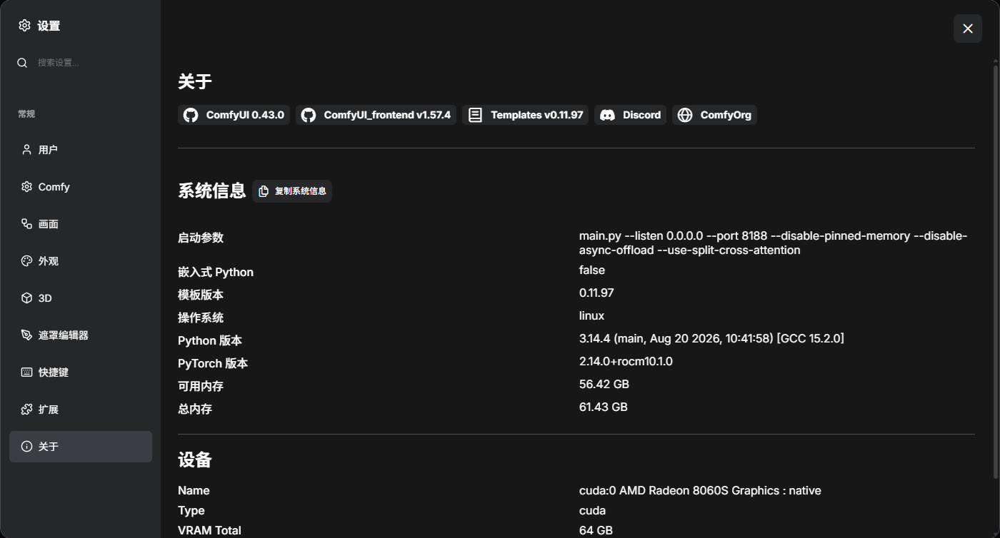

# ComfyUI ROCm 10.1.0 Docker Image

🔥 **ComfyUI Docker image for AMD ROCm**

This image provides a ready-to-use ComfyUI environment for AMD GPUs, based on the official AMD ROCm PyTorch image.

### Software Stack

| Component | Version |
| --- | --- |
| Docker Image | `qinzhen/comfyui-rocm` |
| Base Image | `rocm/pytorch:rocm10.1.0_ubuntu26.04_py3.14_pytorch_release_2.14.0` |
| ROCm | 10.1.0 |
| PyTorch | 2.14.0 |
| Python | 3.14 |
| ComfyUI | 0.43.0 |
| Container OS | Ubuntu 26.04 |

---


## 🖥️ Tested Hardware

This image has been tested on:

| Component | Configuration |
| --- | --- |
| CPU/APU | AMD Ryzen AI MAX+ 395 |
| GPU | AMD Radeon 8060S |
| GPU Architecture | `gfx1151` |
| Host OS | Ubuntu 26.04.1 LTS |
| Memory | 128 GB |

Other ROCm-compatible AMD GPUs may also work, but are not currently tested.

---

## 📋 Requirements

Recommended environment:

- AMD ROCm-compatible GPU
- Ubuntu 26.04.1 LTS
- Docker Engine
- Docker Compose v2
- `/dev/kfd`
- `/dev/dri`
- 64 GB RAM minimum
- 128 GB recommended for large image/video models

---

# 🔧 Install AMD ROCm Driver

For **AMD Ryzen AI MAX+ 395 / gfx1151 / Ubuntu 26.04.1**, follow the official AMD ROCm installation guide:

https://rocm.docs.amd.com/en/latest/install/rocm.html?fam=ryzen&w=compute&gpu=amd-ryzen-ai-max-pro-395&os=ubuntu&ubuntu-ver=26.04.1&i=pkgman&gfx=gfx1151

Ubuntu 26.04 uses the built-in AMDGPU kernel driver.

First verify that AMDGPU is loaded:

```bash
lspci -k | grep -EA3 'VGA|Display'
```

You should see:

```text
Kernel driver in use: amdgpu
```

Install the required packages:

```bash
sudo apt update
sudo apt install -y wget gpg libatomic1 libquadmath0
```

Add the AMD ROCm signing key:

```bash
sudo mkdir -p /etc/apt/keyrings

wget https://stable.repo.amd.com/rocm/gpg/packages.gpg -O - | \
gpg --dearmor | sudo tee /etc/apt/keyrings/amdrocm.gpg > /dev/null
```

Add the ROCm repository:

```bash
sudo tee /etc/apt/sources.list.d/amdrocm-stable.sources << EOF
X-Repo-Id: amdrocm-stable
Types: deb
URIs: https://stable.repo.amd.com/rocm/core/packages/ubuntu2604/
Suites: stable
Components: main
Architectures: amd64
Signed-By: /etc/apt/keyrings/amdrocm.gpg
Enabled: yes
EOF
```

Install ROCm 10.1 for `gfx1151`:

```bash
sudo apt update
sudo apt install amdrocm10.1-gfx1151
```

Add your user to the GPU groups:

```bash
sudo usermod -a -G render,video $LOGNAME
sudo reboot
```

After reboot, verify:

```bash
rocminfo | grep gfx
```

Expected:

```text
gfx1151
```

Also check:

```bash
amd-smi
```

---

# 🐳 Docker Compose

Create the required directories:

```bash
mkdir -p data/models
mkdir -p data/output
mkdir -p data/input
mkdir -p data/custom_nodes
mkdir -p data/user
```

Create `docker-compose.yaml`:

```yaml
services:
  comfyui-rocm:
    image: qinzhen/comfyui-rocm
    container_name: comfyui-rocm
    runtime: runc

    devices:
      - /dev/kfd:/dev/kfd
      - /dev/dri:/dev/dri

    ports:
      - "8188:8188"

    command:
      - python3
      - main.py
      - --listen
      - 0.0.0.0
      - --port
      - "8188"
      - --disable-pinned-memory
      - --disable-async-offload
      - --use-split-cross-attention

    group_add:
      - 993
      - 44

    ipc: host
    shm_size: "16gb"

    security_opt:
      - seccomp=unconfined

    volumes:
      - ./data/models:/workspace/ComfyUI/models
      - ./data/output:/workspace/ComfyUI/output
      - ./data/input:/workspace/ComfyUI/input
      - ./data/custom_nodes:/workspace/ComfyUI/custom_nodes
      - ./data/user:/workspace/ComfyUI/user

    environment:
      - HSA_ENABLE_SDMA=0
      - GPU_MAX_HW_QUEUES=1
      - PYTORCH_NO_HIP_MEMORY_CACHING=1
      - TORCH_CUDNN_ENABLED=0
      - HIP_LAUNCH_BLOCKING=1
      - TORCH_SHOW_CPP_STACKTRACES=1

    restart: unless-stopped
```

> `44` and `993` are the `video` and `render` group IDs on the tested system.
>
> Check your host with:
>
> ```bash
> getent group video
> getent group render
> ```
>
> Change `group_add` if your IDs are different.

---

# 🚀 Start ComfyUI

Pull the image:

```bash
docker pull qinzhen/comfyui-rocm101
```

Start:

```bash
docker compose up -d
```

View logs:

```bash
docker logs -f comfyui-rocm101
```

Open:

```text
http://HOST_IP:8188
```

For example:

```text
http://192.168.1.100:8188
```

---

# 🧪 Tested Models / Workflows

The following models and workflows have been tested on **AMD Ryzen AI MAX+ 395 / Radeon 8060S / gfx1151**:

| Workflow / Model | Status |
| --- | --- |
| `NewBie-Image-Exp0.1-bf16` | ✅ Tested |
| `SDXL Turbo / sd_xl_turbo_1.0_fp16` | ✅ Tested |
| `Z-Image-Turbo / z_image_turbo_bf16` | ✅ Tested |
| `Z-Image-Turbo Fun Controlnet Union` | ✅ Tested |
| `MiniMax H3` The 10-second video was generated successfully, but the 15-second video failed due to insufficient GPU memory. | ✅ Tested |
| `LTX2.5_t2v` 15-second video was generated successfully.Much much faster than `MiniMax H3`| ✅ Tested |
| `Qwen Image 2512 / qwen_image_2512_fp8` | ✅ Tested |
| `Qwen Image Edit 2511 / qwen_image_edit_2511_bf16` | ✅ Tested |

Large Qwen Image models require significantly more memory. **40 GB+ system memory is recommended.**

---

# 🔗 Links

**Docker Hub**

https://hub.docker.com/r/qinzhen/comfyui-rocm101

**AMD ROCm installation guide for Ryzen AI MAX+ 395 / gfx1151 / Ubuntu 26.04.1**

https://rocm.docs.amd.com/en/latest/install/rocm.html?fam=ryzen&w=compute&gpu=amd-ryzen-ai-max-pro-395&os=ubuntu&ubuntu-ver=26.04.1&i=pkgman&gfx=gfx1151

**ComfyUI**

https://github.com/Comfy-Org/ComfyUI

**AMD ROCm**

https://rocm.docs.amd.com/
